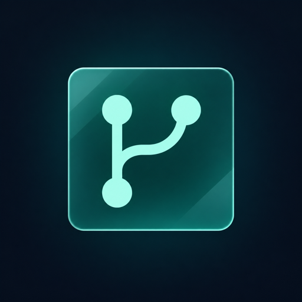
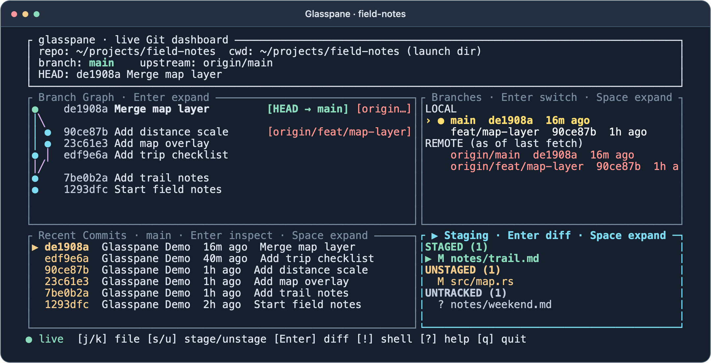

# Glasspane



**A live Git dashboard for your terminal.** See your branch, commit history, and working tree at a glance. Stage files, review commits, and drop into your shell without leaving the current terminal.

[Quick start](#quick-start) · [Keyboard shortcuts](#keyboard-shortcuts) · [User guide](docs/guide.md)



## Quick start

On macOS, install stable Rust, Git, and the Xcode Command Line Tools (`xcode-select --install`). Clone this repository or open your existing copy. From the project directory, run

```sh
cargo install --locked --path .
```

Open a Git repository in your terminal and run `glass`.

| Command | What it does |
| --- | --- |
| `glass` | Open the dashboard for the current directory |
| `glass /path/to/repo` | Open the dashboard for a specific repository |
| `glass summary` | Print the branch, latest commit, and file counts inline |

Enable [optional zsh directory tracking](docs/guide.md#shell-directory-tracking-optional) to make the dashboard follow your shell between repositories.

## What you can do

| View | Workflow |
| --- | --- |
| **Graph** | Read branch and merge history, then expand the graph to see more detail. |
| **Branches** | Browse local and remote-tracking refs. Switch branches with Git’s protections for local edits. |
| **Recent Commits** | Inspect a commit’s message, author, changed files, and per-file diffs. |
| **Staging** | Preview staged or unstaged changes and stage or unstage whole files. |
| **Commit and amend** | Review the files you’re about to commit, or amend the latest commit’s message or staged contents. |
| **Shell** | Run Git or other terminal commands in the current repository. Exit the shell to return to a refreshed dashboard. |

Glasspane refreshes as local files and Git metadata change. Fetch and push through your regular Git CLI, including from the dashboard’s shell.

## Keyboard shortcuts

| Key | Action |
| --- | --- |
| `Tab` / `Shift+Tab` | Cycle through panels |
| `↑` / `↓` or `k` / `j` | Move the selection or scroll |
| `Enter` | Switch branch, inspect a commit, or open a file diff |
| `Space` | Expand or restore the focused panel |
| `s` / `u` | Stage or unstage the selected file |
| `c` / `a` | Review a new commit or amend the latest one |
| `!` | Open a shell. Use `exit` to return. |
| `?` / `q` | Show help or quit |

## Development

```sh
cargo run -- /path/to/repo
./scripts/check.sh
```

The check script runs formatting, tests, Clippy, and a release build. macOS is the primary platform. See the [user guide](docs/guide.md#limitations-and-next-steps) for platform and feature limits, [design decisions](DECISIONS.md) for architecture, and [validation notes](VALIDATION.md) for test coverage.
